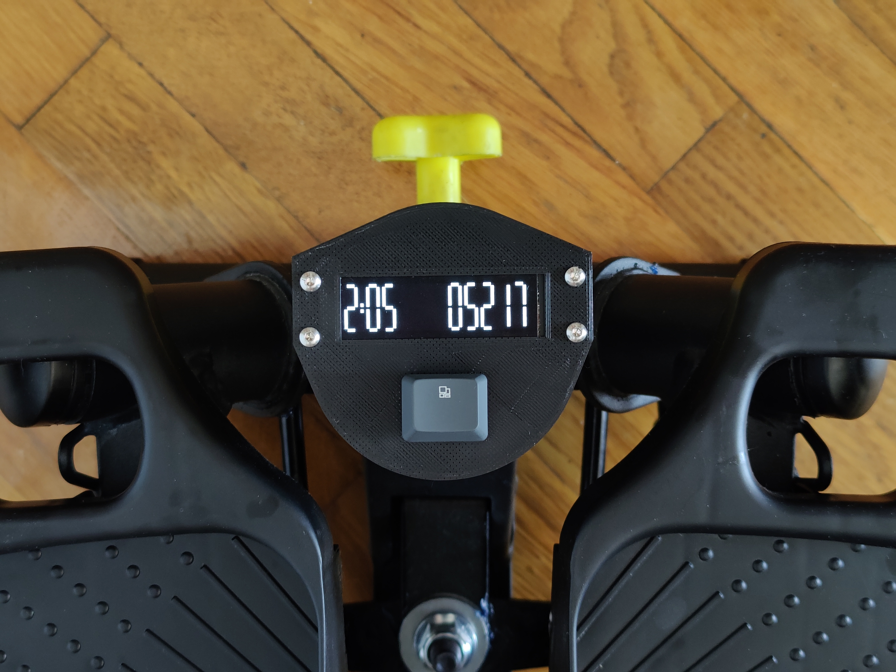

# Habits Stepper


Automatically tracks workouts and sends them to a JSON backend over Wi-Fi. NTP synchronization handles day and week boundaries automatically, so there is no need to reset counts on Monday.

## Features
* automatic tracking of stepping sessions
* time-synchronized via NTP with a compile-time IANA timezone
* deep sleep after 120 seconds of inactivity and approximately two weeks of battery life with an 18650 battery
* firmware upload, logs, and battery charging over a single USB-C port
* persistent workout storage in NOR flash that survives deep sleep and reboots
* 3D-printed case with a 256x64 OLED display

## Documentation
* [Deep sleep](doc/features/deep-sleep.md)
* [Time synchronization](doc/features/time-sync.md)
* [Session tracking](doc/features/sessions/tracking.md)
* [Permanent session storage](doc/features/sessions/permanent-storage.md)
* [Backend sync](doc/features/sessions/backend-sync.md)
* [Mechanical maintenance](doc/hardware/mechanical-maintenance.md)
* [Wiring](doc/hardware/wiring.md)
* [Project boundaries](doc/boundaries.md)

## Tests
Tests require a connected MCU.

```
nix develop
cargo test
```

## Build & Flash
```
nix develop

JWT_TOKEN="<jwt-token>" SSID="skynet-2" PASS="<pass>" METRICS_URL="https://api.habits.rusty-cluster.net/metrics" cargo run --release

03:00:00.0 [INFO ] init: embassy initialized
01:18:02.0 [INFO ] time: rtc seeded: Europe/Moscow 2026-11-21 01:18:02
01:18:02.0 [INFO ] storage: flash capacity: 4194304B
01:18:02.0 [INFO ] storage: loaded 144 sessions from flash (head=144)
01:18:02.0 [INFO ] time: waiting 120s for inactivity
01:18:02.0 [INFO ] wifi: connecting to "skynet-2"
01:18:03.9 [INFO ] wifi: connected to "skynet-2"
01:18:03.0 [INFO ] sync: task started (chain_id=19)
22:40:17.0 [INFO ] time: synced (-9466s)
22:40:17.0 [INFO ] time: Europe/Moscow 2026-11-20 22:40:17
22:40:17.0 [INFO ] time: NTP sync complete
22:40:17.0 [INFO ] display: session update: 125min(5231steps)
```

## Logs
```
nix develop
cargo build --release

probe-rs attach --no-location --always-print-stacktrace target/riscv32imc-unknown-none-elf/release/habits-stepper
```
